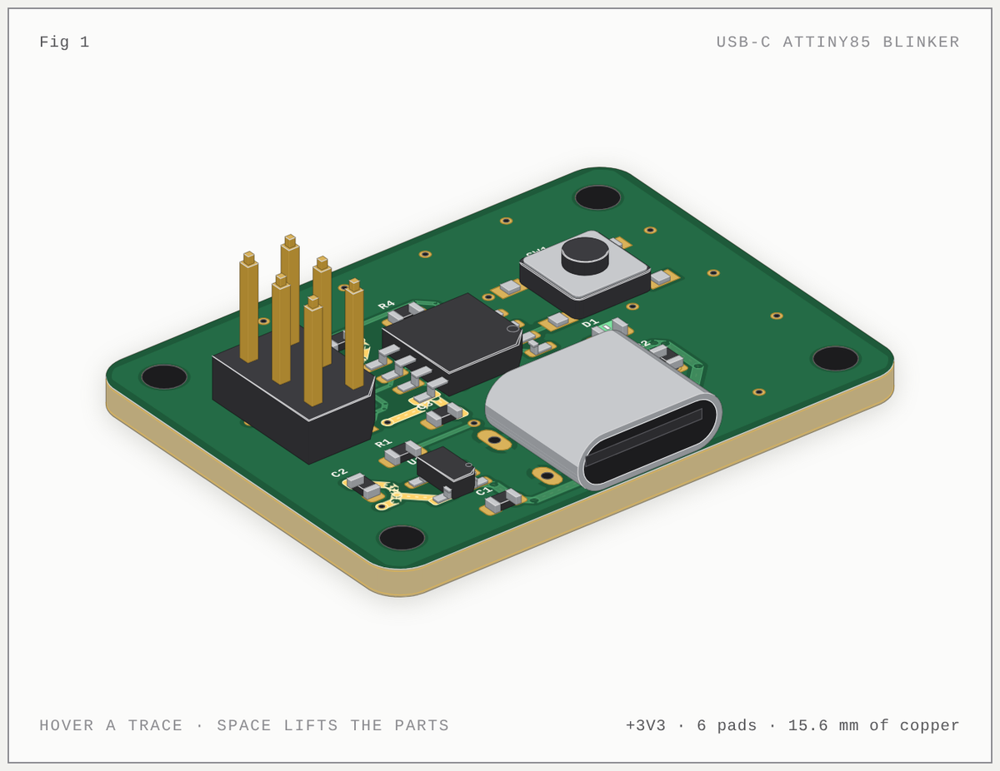
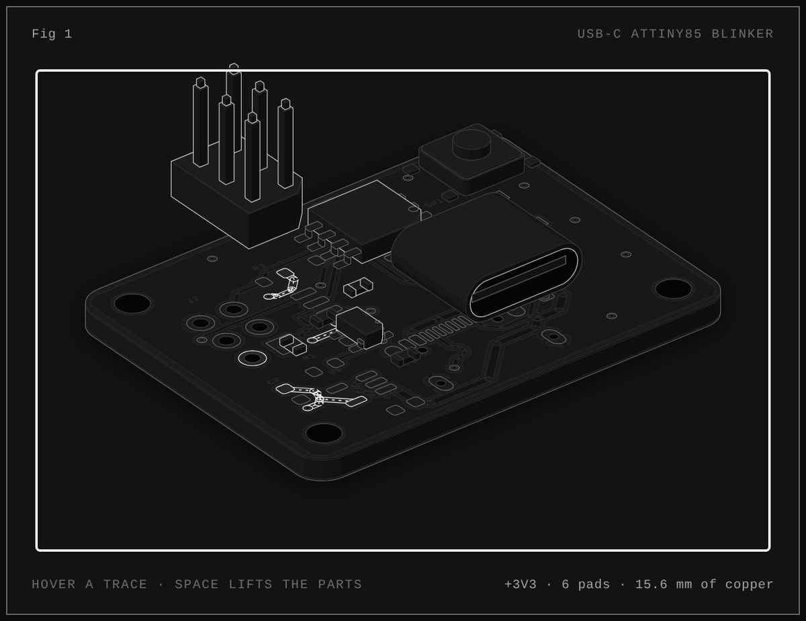
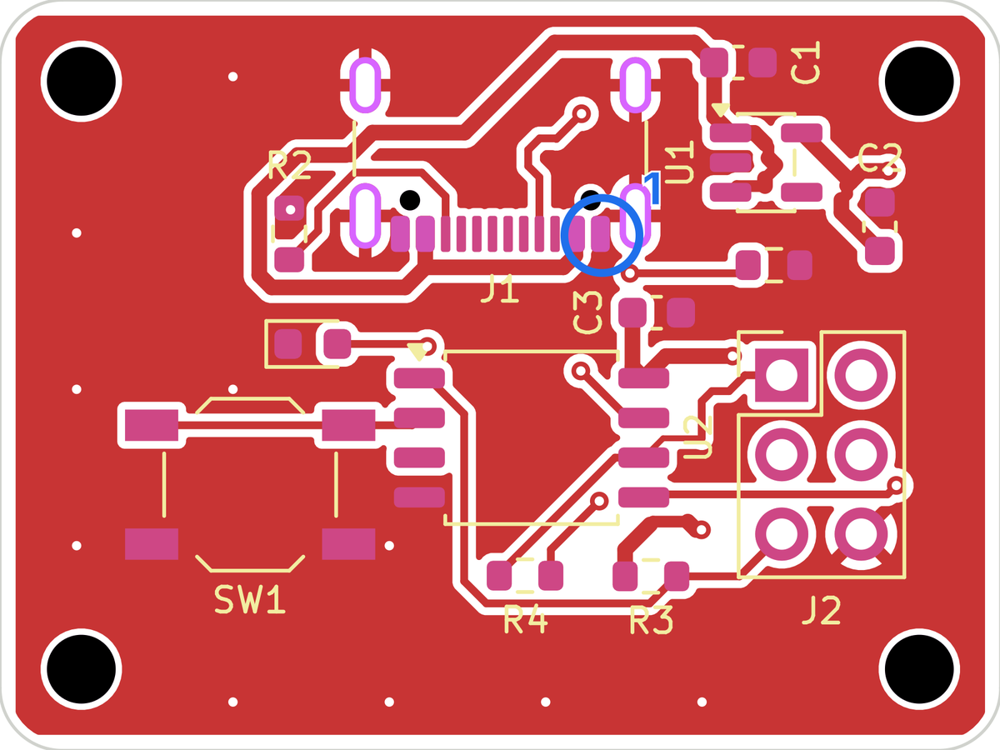
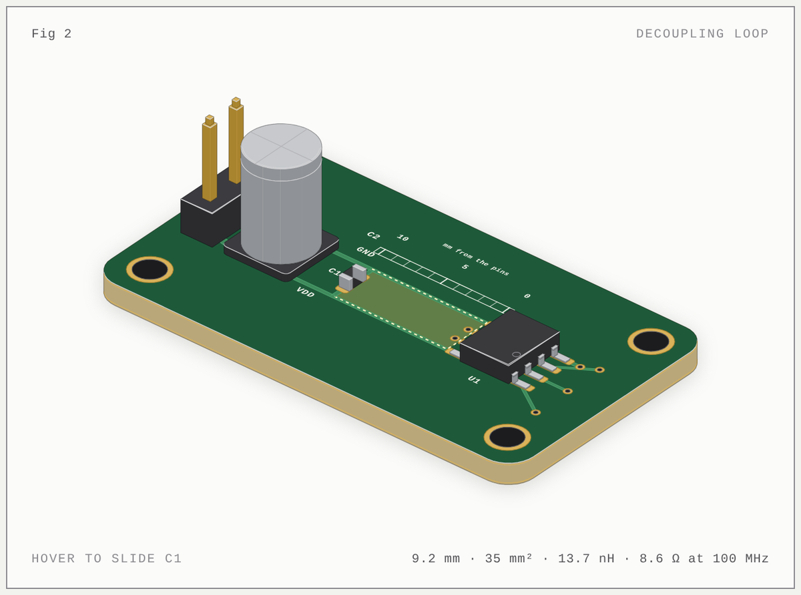
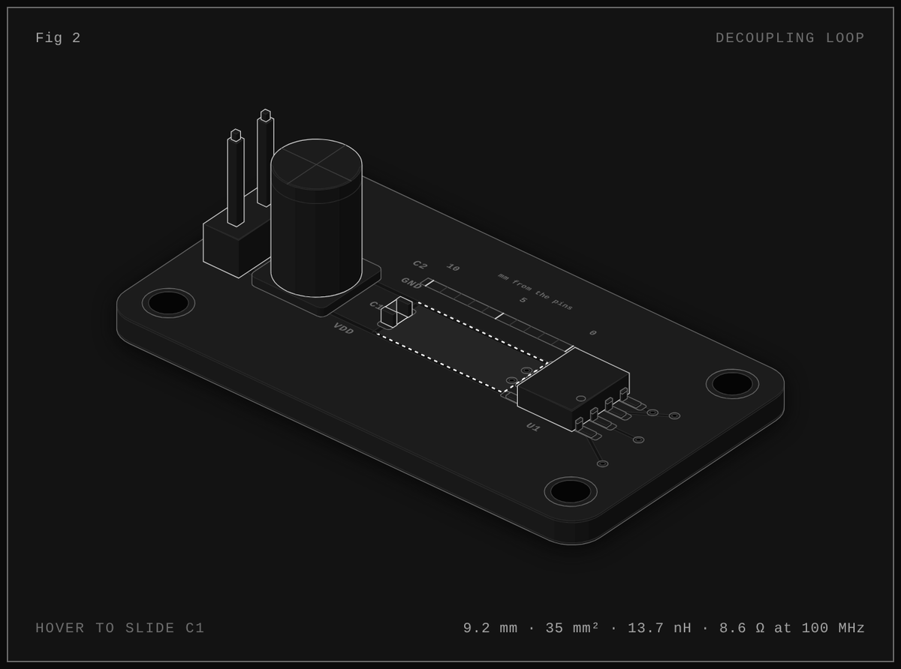

# PCB Anatomy

**An agent skill for hardware: design boards in KiCad, review them, and draw them.**
Modelled on [Anatomy](https://github.com/wheresryan22/anatomy), whose isometric figure kit it builds on.



`examples/usb-blinky`, drawn from its own `.kicad_pcb`: every part at its package height, the +3V3 net lit with current flowing along it.

---

One skill, three modes:

| Mode | You ask for | You get |
|---|---|---|
| **Design** | "a USB-C powered ATtiny85 board, 32 × 24 mm, two layers, JLCPCB" | a KiCad 9/10 project built from one circuit spec: schematic (netlist parity and ERC clean), placed and autorouted board (DRC clean, ground stitched), renders, a self-review and fab outputs (Gerbers, drill, BOM, positions, IPC-2581, JLCPCB formats) |
| **Review** | "check this KiCad project before I order it" | a ranked report (blocker, major, minor, info) from ERC, DRC with schematic parity, fab limits, decoupling distances, floating inputs, current capacity, pair matching and BOM completeness, with every finding ringed on the board, plus the datasheet checks no script can do |
| **Illustrate** | "draw my board for the README" or "explain why decoupling caps sit by the pins" | an interactive isometric figure, from a real `.kicad_pcb` or an invented board built around the idea, in Anatomy's craft: solid parts, live readout from a true model, calm motion, checked in a headless browser |

## Quick start

```bash
git clone https://github.com/aguirrem/pcb-anatomy.git ~/.claude/skills/pcb-anatomy
bash ~/.claude/skills/pcb-anatomy/scripts/kicad/setup.sh      # KiCad 10, libraries, Java 25, Freerouting, headless Chrome
```

Then in Claude Code: `/pcb-anatomy design a breakout board for the BME280, I2C, 3.3 V, castellated edges`. In the Claude app, upload the folder as a skill (zip it with `SKILL.md` at the root). Claude also picks the skill up whenever you ask for anything PCB, schematic, KiCad, Gerber or hardware-figure shaped.

## Gallery

| | |
|---|---|
|  |  |
| **Space lifts the parts** off their pads on springs, so the copper under them shows. Monochrome "ink" palette. | **Review:** findings ringed and numbered on the board, matched to `review.md`. |
|  |  |
| **An idea figure:** slide C1 along the rails and the loop it closes with the chip's supply pins grows; the readout gives its inductance and its impedance at 100 MHz from `model.mjs`. | The same, dark theme, ink palette. |

## How it works

**Design** starts from a circuit spec (`spec.yaml`): parts as KiCad library symbols and footprints, nets as `REF.PIN` lists, deliberate no-connects, board size, rules, pours, and the placement of the parts that matter. `sch_build.py` writes the schematic and proves KiCad's netlist equals the spec; `pcb_build.py` builds the board from that netlist, places the anchors where the spec says and the passives next to what they serve (decoupling caps at supply pins); `route.py` routes with [Freerouting](https://github.com/freerouting/freerouting), refills pours and stitches ground; `outputs.py` writes fab files and refuses a board that fails DRC. `partgen.py` makes symbols and IPC-7351 footprints for parts KiCad lacks. Every step renders PNGs, and the skill tells Claude to look at them.

**Review** (`review.py`) works on any KiCad 8–10 project. The script does the measurable checks; `SKILL.md` and `references/review.md` give Claude the second pass: datasheets, reference circuits, protection, dissipation, manufacturability.

**Illustrate** extends Anatomy's kit (vendored, MIT, in `kit/anatomy/`) with `kit/pcb.mjs`: boards, copper, pads, vias, and packages built from footprint geometry (chips with tinned caps, gull-wing ICs with bent leads, QFNs, headers, USB-C shells, nylon housings, tactile switches, axial and disc parts, electrolytics, LEDs). `board_dump.py` reads a real board; `board-figure.mjs` makes the interactive page. Invented boards are built in millimetres with the same parts, driven by a pure model.

## Layout

```
pcb-anatomy/
├── SKILL.md                    what Claude reads: modes, workflow, rules
├── references/                 setup, spec format, design, parts, review, figures; anatomy/ (Anatomy's craft guides)
├── scripts/kicad/              setup.sh, find_part, sch_build, pcb_build, route, stitch, review, outputs,
│                               render, partgen, board_dump, and their helpers (sexp, spec, libsym, fplib, silk, kienv)
├── scripts/figure/             board-figure.mjs, and Anatomy's capture, drive and lines checks
├── kit/pcb.mjs                 PCB parts, palettes, boardFigure and its live script
├── kit/anatomy/                Anatomy's isometric kit, unchanged (MIT)
├── examples/usb-blinky/        a complete design: spec → schematic → board → review → fab → figure
├── examples/decoupling-loop/   an idea figure and its model
└── evals/evals.json            test prompts and what a good answer contains
```

## Requirements

KiCad 9 or 10 with `kicad-cli` and its Python module (design and review), Java 25 and Freerouting 2.5 (routing), Node.js 20.10+ and a headless Chrome (figures), PyYAML and librsvg. `scripts/kicad/setup.sh` installs or checks all of them on Linux and macOS and explains Windows; `references/setup.md` covers proxies, sandboxes and bundled-Python platforms.

## Limits

- **Autorouting is for simple and medium boards.** Route high-speed pairs, RF, crystals and switching-regulator loops by hand first; the skill says so and keeps your tracks with `--keep-tracks`.
- **Auto-placement only fills in.** Connectors, ICs and regulators are placed by intent in the spec.
- **The review is a second pair of eyes, not a sign-off.** Mains, high-current, RF, medical and safety-critical hardware need a qualified engineer.
- **Package heights in figures are guessed from footprint names** and can be corrected per part.

## License

MIT. The isometric kit in `kit/anatomy/`, the figure check scripts in `scripts/figure/` (except `board-figure.mjs` and `inline-kit.mjs`) and the guides in `references/anatomy/` come from [Anatomy](https://github.com/wheresryan22/anatomy) © 2026 Ryan, also MIT; see `kit/anatomy/LICENSE`. KiCad and Freerouting are installed separately under their own licences.
